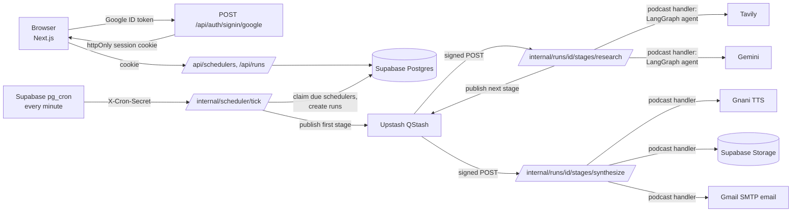
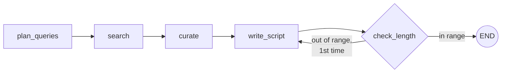

# How DailyCast works

This explains the system end to end: what each piece does, how a request moves through it, and why it was built this way. Code references point to files under `backend/`.

---

## 1. The core idea: generic schedulers, type-specific handlers

The backend is a **generic daily scheduler**. The podcast is the first **type** of scheduler plugged into it.

| Concept | Table | Generic part | Type-specific part (jsonb) |
|---|---|---|---|
| **Scheduler**: "do X once / daily / weekly / monthly at 08:00 in my timezone" | `schedulers` | `type`, `name`, `frequency`, `run_time`, `run_date`, `days_of_week`, `day_of_month`, `timezone`, `next_run_at`, `is_active` | `config`. Podcast: `{"topic": "..."}` |
| **Scheduler run**: one execution of a scheduler | `scheduler_runs` | `status`, `stage`, `trigger`, `scheduled_for`, timings, `error` | `output`. Podcast: `{title, script, sources, audio_path, duration_sec}` |

The tick, queue, run executor and API don't know anything about podcasts. Everything podcast-specific sits behind one interface, `SchedulerHandler` (`app/handlers/base.py`):

| Handler member | Podcast implementation |
|---|---|
| `config_model` | `PodcastConfig(topic)` validates `schedulers.config` |
| `stages` | `("research", "synthesize")`, each executed as its own queued job |
| `run_stage(stage, ctx)` | research: LangGraph agent writes the script. synthesize: Gnani TTS, then MP3, then storage. |
| `present_output(output)` | Replaces the private `audio_path` with a signed `audio_url` |
| `on_completed(ctx, output)` | Emails the user a link to the run |

**Adding a new type** (for example a daily newsletter) takes four things: a `SchedulerType` value, a handler class, one line in `handlers/registry.py`, and the value added to the DB `type` check. The core doesn't change.

---

## 2. The big picture



Three kinds of callers, each authenticated differently:

| Caller | Endpoints | How it's authenticated |
|---|---|---|
| A signed-in user | `/api/*` | httpOnly session cookie (or `Authorization: Bearer` for scripts) |
| The scheduler (pg_cron) | `/internal/scheduler/tick` | `X-Cron-Secret` shared secret, compared in constant time |
| The queue (QStash) | `/internal/runs/{id}/stages/{stage}` | `Upstash-Signature` JWT signed over the exact URL and a hash of the body |

---

## 3. Sign-in, sessions and isolation

**Files:** `app/core/security.py`, `app/core/dependencies.py`, `app/controllers/auth_controller.py`, `app/routes/auth.py`

| Endpoint | What it does |
|---|---|
| `POST /api/auth/signin/google` | Verifies the Google ID token, upserts the user, sets the session cookie |
| `POST /api/auth/signup` | Creates an email + password account (password 8–128 chars), sets the session cookie. 409 `EMAIL_TAKEN` if the email exists |
| `POST /api/auth/signin/password` | Checks email + password, sets the session cookie. 401 `INVALID_CREDENTIALS` on any mismatch |
| `POST /api/auth/signout` | Clears the session cookie |
| `GET /api/auth/session` | Returns the current user, or 401. The frontend calls it on load. |
| `POST /api/auth/signin/dev` | **Local only** (`ALLOW_DEV_LOGIN=true`): sign in by email and also get the token for curl |

1. The frontend shows Google's sign-in button. Google returns an **ID token**, a JWT signed by Google.
2. `verify_google_id_token()` checks it against Google's public keys (JWKS, cached), plus `aud == GOOGLE_CLIENT_ID`, `iss`, expiry and `email_verified`.
3. The user is upserted by `google_sub`, Google's stable id. Emails can change; `sub` doesn't.
   If no account has that `sub` but one has the same email (e.g. created with a password), Google is linked to it.
   Because Google has just proven the person owns that email, any password set before is removed, so nobody can
   pre-register someone else's email and keep access once the real owner signs in.
4. We issue **our own** HS256 session JWT (`sub = users.id`, 7 days) and set it as a cookie with these flags:
   - **httpOnly**: page JavaScript can't read it, so an XSS bug can't steal the session.
   - **Secure**: sent only over HTTPS. `SESSION_COOKIE_SECURE=false` only for localhost.
   - **SameSite=Lax**: the browser doesn't attach it to cross-site POSTs, which blocks CSRF.
   - The Next.js app proxies `/api/*` to the backend, so the cookie is first-party.
5. `get_current_user_id` reads the cookie first, then a Bearer header for curl and scripts.

**Email + password.** One account per email (case-insensitive unique index, migration `006_password_auth.sql`).
Passwords are hashed with **scrypt** (Python stdlib, random 16-byte salt, N=2^14) and compared in constant time.
Sign-in returns the same error for an unknown email, a wrong password and a Google-only account, and still hashes
a dummy password when the email is unknown, so neither the message nor the timing reveals who has an account.
Not included (would come next): email verification, password reset, and rate limiting of sign-in attempts.

**Isolation.**
- Every user-facing SQL query has `WHERE user_id = $current_user`.
- Asking for another user's scheduler or run returns **404, not 403**, so an attacker can't learn which ids exist.
- RLS is enabled with no policies, which blocks Supabase's auto-generated public REST API.
- Audio sits in a **private** bucket and is only reachable through 6-hour signed URLs, created after the ownership check.

---

## 4. Schedulers and timezone-correct scheduling

**Files:** `app/utils/scheduling.py` (the rules), `app/controllers/scheduler_controller.py`, `app/schemas/scheduler.py`, `supabase/migrations/003_recurrence.sql`

A scheduler runs on one of four frequencies, always at a local `run_time` in an IANA `timezone`:

| `frequency` | Extra field | Example | Next run |
|---|---|---|---|
| `once` | `run_date` (or `run_now: true`) | Once on 1 Dec at 10:00 | that moment; afterwards the scheduler is deactivated ("Done") |
| `daily` | none | Daily at 08:00 | today at 08:00, or tomorrow if passed |
| `weekly` | `days_of_week` (0 = Mon … 6 = Sun) | Weekly on Mon, Wed, Fri at 07:30 | the next listed weekday at that time |
| `monthly` | `day_of_month` (1–31) | Monthly on the 31st at 09:00 | that day each month; **short months use their last day** (30 Nov, 28 Feb) |

- `next_run_at` stores the **UTC instant** of the next run, so the tick's question is one indexed query, `WHERE is_active AND next_run_at <= now()` (partial index `schedulers_due_idx`).
- **One rule, used everywhere:** `next_run_after(recurrence, after)` in `utils/scheduling.py` computes the next occurrence on *local* dates through `zoneinfo`, so daylight saving is handled. The API uses it on create and edit, the tick uses it to advance after each run, and `POST /api/schedulers/preview` uses it for the form's live "next 3 runs" list. What the user sees is exactly what the scheduler will do. Unit tests are in `tests/test_recurrence.py`.
- **Validation:** a weekly schedule with no days, a monthly day outside 1–31, a one-time slot in the past, or a bad timezone gets a 422 with a readable message. `config` is validated by the type's handler (podcast: `config.topic: String should have at least 3 characters`).
- **"Once, right now"** (`frequency: "once", run_now: true`) creates the scheduler already consumed (inactive) and starts a manual run in the same request. The response's `triggered_run_id` lets the UI jump straight to the live episode page.
- Editing any timing field, or re-activating, recomputes `next_run_at`. Fields that don't belong to the new frequency are cleared, and rescheduling a finished one-time job brings it back.
- `POST /api/schedulers/{id}/trigger` starts a **manual** run immediately and leaves the schedule alone (409 if one is already in progress).
- `GET /api/schedulers/types` lists the supported types with their stages and the config's JSON schema, so the frontend can build forms from it.

---

## 5. The scheduler tick

**Files:** `app/controllers/tick_controller.py`, `app/repositories/scheduler_repository.py` (`claim_due_and_create_runs`), `supabase/migrations/002_cron.sql`

Vercel's free plan only allows a daily cron, so the clock lives in the database. **pg_cron** runs every minute and uses **pg_net** to POST to `/internal/scheduler/tick`.

The tick runs in **one database transaction**:
1. `SELECT … WHERE is_active AND next_run_at <= now() FOR UPDATE SKIP LOCKED` locks the due schedulers. An overlapping tick skips rows already claimed instead of waiting or double-claiming.
2. For each one, `next_run_after()` (the same rule as the API) computes the next occurrence. A one-time scheduler has none, so it's set inactive.
3. One `pending` run is inserted per slot with `ON CONFLICT (scheduler_id, scheduled_for) DO NOTHING`. The unique key makes a repeated tick a no-op.

The advance is computed in Python rather than SQL because weekly and monthly rules (weekday sets, month-length clamping) are far clearer, and unit-testable, in one function. The `FOR UPDATE` lock keeps it just as safe under concurrency.

For each new run, the tick publishes the **type's first stage** to the queue. If publishing fails, the run is marked `failed` with the reason. After downtime, a scheduler jumps to the next *future* slot: it runs once to catch up, not once for every missed occurrence.

---

## 6. Runs, stages and the queue

**Files:** `app/workers/run_executor.py`, `app/controllers/stage_controller.py`, `app/services/queue.py`, `app/models/scheduler_run.py`

A serverless function can't keep working after it responds, and each call has a time limit. So each **stage** is a separate queued HTTP job. QStash stores the message, calls `/internal/runs/{id}/stages/{stage}`, and retries with backoff on any non-2xx.

**Run lifecycle.** Generic for every type:
```
pending --(stage 1)--> running --(stage 2)--> ... --(last stage)--> completed
                           \___________ any stage fails ___________> failed
```
`status` says *where in the lifecycle* the run is, and `stage` says *which step* runs next (podcast: `research` → `synthesize`).

**`execute_stage(run_id, stage)` is idempotent.** QStash delivers *at least once*, so the same stage can arrive twice:

| Situation | Action |
|---|---|
| Run already completed or failed, or deleted | skip |
| `stage` is the expected next stage | run it, merge its result into `output`, then publish the next stage or complete the run |
| `stage` already finished (duplicate delivery) | skip, and re-publish the expected next stage in case that publish was lost. QStash `Deduplication-Id = {run}-{stage}` prevents doubles. |

**Retry policy** (`stage_controller.run_stage`):
- A temporary error returns **500**, and QStash retries up to 3 times.
- On the last retry (`Upstash-Retried` header), the run is marked `failed` with the error and we return 200.
- `PermanentJobError` (for example "No recent sources found" or an unknown stage) fails the run immediately.
- A failed notification (email) **doesn't** fail the run. The output is already saved, and retrying would pay for the work again.

Retries happen at three levels:

| Level | Where | What it handles |
|---|---|---|
| 1. Per call | `services/llm.py`, `services/tts.py` | Gemini: retry, then fail over across the model chain (2 passes). Gnani: up to 5 attempts with backoff on 429/5xx. |
| 2. Per stage | QStash (or the local executor) | The whole stage is re-run up to 3 more times with backoff. `scheduler_runs.attempts` counts every start. |
| 3. Manual | **Retry** button → `POST /api/runs/{id}/retry` | For a run that still ended `failed` (e.g. a retired model before the config was fixed). |

**Manual retry resumes from the failed stage.** It sets the run back to `pending` at the stage stored in `scheduler_runs.stage`, clears the error, increments `retry_count`, and enqueues only that stage. Output from earlier stages is kept, so a failed audio step reuses the script and doesn't spend Gemini quota again. Retrying a run that isn't `failed` returns 409, and another user's run returns 404. The episode page shows "Failed at *stage* after *N* attempts" next to the Retry button.

**Local mode.** QStash can't reach `localhost`, so with `QUEUE_MODE=local` the same `execute_stage` runs as an in-process asyncio task with the same retry rules.

---

## 7. The podcast handler

**Files:** `app/handlers/podcast/handler.py`, `config.py`, `agent/`

### Stage 1: `research`, a LangGraph agent



| Node (`agent/nodes.py`) | What it does | Why |
|---|---|---|
| `plan_queries` | Gemini turns the topic into 3–5 varied queries (structured JSON output), and the user's own wording is always kept as one | Better recall than a single query |
| `search` | Runs all queries **in parallel** against Tavily's **news** index with `days=1`. With fewer than 3 hits it widens to 3 days. | Satisfies "current, real sources" and handles quiet days |
| `curate` | Removes duplicate URLs and near-identical headlines (similarity > 0.85) and keeps the top 12. With nothing left it raises `NoSourcesError`, which is permanent. | No repeated stories, focused prompt |
| `write_script` | Gemini writes `{title, paragraphs[10–12]}` only from the numbered sources (snippet plus up to 2,000 characters of each article's text) | Grounded, which is the hallucination guard. The paragraph count is enforced by structured output (`minItems`), which keeps even Lite models near five minutes. |
| `check_length` | Target 760 words (Gnani reads ~150–155 wpm, so about 5 min), accepted 699–820. Out of range → **one** rewrite that *edits the previous draft*. The draft closest to the target wins. | About 5 minutes, with a bounded loop and no regressions |

The writer prompt asks for listening-friendly prose: no markdown or URLs, numbers and money written as words, facts attributed to their outlet, and only the given sources used.

**Why a fixed graph rather than a free-form agent?** The task has a known shape. A fixed graph gives predictable cost (2–3 Gemini calls per episode) and latency, makes each node testable on its own, and is easy to debug. The conditional rewrite is where an actual decision is needed.

Output: `{title, script, word_count, sources}`

### Stage 2: `synthesize`, Gnani TTS

- `POST https://api.vachana.ai/api/v1/tts/inference` with header `X-API-Key-ID`. Defaults: model `timbre-v3.0`, voice `Shivani`, language `en-IN`, MP3 at 44.1 kHz and 128 kbps.
- The script (about 4,500 characters) is split on **sentence boundaries** into chunks of at most 1,200 characters. They're synthesized **one at a time**, because Gnani allows 1 active request per account (`GNANI_CONCURRENCY`), with backoff retries on 429 and 5xx. A 5-minute episode takes about 30 seconds.
- The MP3 frames are **joined byte by byte**, so no ffmpeg is needed on serverless. Duration ≈ bytes × 8 / 128k.
- The file is uploaded to the private bucket at `artifacts/podcasts/{user_id}/{run_id}.mp3`.

Output: `{audio_path, duration_sec, audio_format}`

### On completion

The user is emailed a link to `FRONTEND_URL/runs/{run_id}` through Gmail SMTP (`EMAIL_PROVIDER=smtp`, sent from your Gmail with an App Password) or Resend (`EMAIL_PROVIDER=resend`, needs a verified domain). The page requires sign-in, so the audio is never public.

---

## 7b. Telemetry: `llm_run_traces` and the context budget

**Files:** `app/core/tracing.py`, `app/repositories/trace_repository.py`, `supabase/migrations/004_llm_run_traces.sql`, `frontend/src/components/RunTraces.tsx`

Every external call made while a run executes is stored as a row in **`llm_run_traces`**:

| `kind` / `name` | Recorded |
|---|---|
| `llm` / `gemini.generate_content` (one row per **attempt**, including failovers) | requested model vs model that answered, attempt number, system prompt, prompt, response (each truncated to 20 KB), input / output / thinking / total tokens (from Gemini's `usage_metadata`), prompt size in chars, latency, status and error |
| `tool` / `tavily.search` | query, days window, result count, characters returned, each result's title/url/score, latency, status |
| `tool` / `gnani.tts` (one row per chunk attempt) | characters sent, text preview, model/voice/language, audio bytes and seconds, latency, HTTP errors |

Every row is tagged with `run_id`, `user_id`, `stage` (research / synthesize) and `node` (plan_queries / search / write_script / synthesize).

**How it's wired, without touching business logic:**
- The run executor opens `tracing.run_scope(run_id, user_id, stage)` around each stage.
- Agent nodes are decorated `@traced_node("…")`.
- The Gemini, Tavily and Gnani wrappers call `tracing.record(...)`.
- The context travels in `contextvars`, so it also reaches the parallel Tavily tasks.
- Recording is best-effort: a telemetry failure is logged and never fails an episode.
- In the CLI (`scripts/run_agent.py`) the same traces are collected in memory and printed.

**Where to see it:**
- **API:** `GET /api/runs/{id}/traces` returns the rows plus a summary: LLM calls, failed attempts, tool calls, token totals, the largest prompt, total external latency, and the models that answered.
- **UI:** a **Trace** section on each episode page, with expandable prompt and response per step.

**Note on "tool calls":** the agent uses a fixed LangGraph pipeline, not LLM-driven function calling, so the "tools" are the deterministic Tavily and Gnani steps. If function calling is added later, its calls would be recorded the same way.

**Context budget (keeping the LLM input concise):**
1. **Curation before the LLM:**
   - Social posts and homepages are dropped.
   - Duplicate URLs and near-identical headlines (syndicated copies of one story) are removed.
   - **Undated, evergreen pages** ("five fundraising tips") are dropped when there are at least 6 dated news articles.
   - At most 12 sources are kept.
2. **Hard cap on source text:** `SOURCE_CONTEXT_CHARS = 24,000` characters (about 6k tokens) are shared evenly across the sources, at most 2,000 each, and each excerpt is cut at a sentence boundary. More sources means shorter excerpts, so the prompt size stays roughly constant.
3. **Warning threshold:** any prompt over `LLM_MAX_INPUT_CHARS = 40,000` is logged as over budget.
4. **Measured, not assumed:** typical traces show the planner at about 110 input tokens and the writer at about 5–7k input / 500–850 output tokens. A research run totals about 11–14k input tokens across 3 LLM calls. Rewrites add the previous draft, so the largest prompt is about 24–27k characters.

---

## 7c. Episode length, voices and follow-along playback

**Episode length** (`config.duration_seconds`: 15, 30, 60, 120, 300 or 600 seconds; default 300). `text_utils.length_plan()` derives everything from it:

| | 15 s | 1 min | 5 min | 10 min |
|---|---|---|---|---|
| Target words (152 wpm) | 38 | 152 | 760 | 1,520 |
| Paragraphs (enforced by schema `minItems`) | 1 | 2 | 10 | 20 |
| Max sources | 2 | 2 | 12 | 16 |
| Source context budget | 4k chars | ~5k | ~24k | 40k |
| Structure | one paragraph, no recap | one paragraph, no recap | intro, themes, recap | written in **2 parts**, joined |

- Tolerance is ±8%, but never tighter than ±8 words, so 15-second episodes aren't impossible to satisfy.
- One writer call reliably covers about 5 minutes, so longer episodes are written in parts: the sources are interleaved across parts, part 1 opens the show, and the last part recaps and signs off.
- Lite models write about 25% short, so the prompt asks for more (`WRITER_LENGTH_BOOST = 1.3`) while the length check still uses the real target. Free-tier Lite output still varies by ±25%; a full model (`GEMINI_MODEL=gemini-3.8-flash` with billing) is more precise.

**Voices and language** (`config.voice`, `config.language`):
- `handlers/podcast/voices.py` holds Gnani's **Timbre v3.0 catalog**: 34 voices, each with gender, persona and use case. Every voice speaks all **10 languages** (English (India), Hindi, Tamil, Telugu, Kannada, Malayalam, Marathi, Bengali, Gujarati, Punjabi).
- Config validation normalises the voice name, because Gnani names are case-sensitive, and rejects unknown voices or languages.
- **The script is written in the chosen language** (the writer prompt says "Write the script and the title in Hindi"), and the TTS call uses the same voice and language.
- `GET /api/podcast/voices` returns the catalog. `GET /api/podcast/voices/{voice}/preview?language=` synthesizes a short sample **once** and caches it in storage (`voice-previews/…`), so browsing voices costs credits only on the first play. In testing that was about 7 s the first time and about 1.6 s from cache.

**Follow-along highlighting:**
- TTS already works chunk by chunk, and each chunk's audio length is exact (constant-bitrate MP3: bytes × 8 / 128k). `tts.sentence_timings()` records `{text, start, end}` for every sentence: chunk boundaries are exact, and time inside a chunk is shared by sentence length.
- The timings are stored in `output.timings`.
- The episode page's `EpisodePlayer` highlights the sentence being spoken (smooth updates while playing), dims what's coming, auto-scrolls when "Follow along" is on, and **jumps the audio to any sentence you click**.
- Episodes generated before timings existed fall back to an estimate from text length.

---

## 7d. Guardrails and evaluation

**Files:** `app/handlers/podcast/agent/guardrails.py`, `app/handlers/podcast/agent/evaluation.py`, `app/handlers/podcast/handler.py`, `frontend/src/components/QualityPanel.tsx`

The agent graph is now:

```
guard_input -> plan_queries -> search -> curate -> write_script -> check_length -> evaluate -> guard_output
```

### Guardrails (LangChain agent middleware)
| Check | Built with | Where it runs | What happens |
|---|---|---|---|
| PII in the topic | LangChain `PIIMiddleware` (`email`, `credit_card`, `ip` built in; custom regex detectors for `phone`, `aadhaar`, `pan`, `api_key`) | On save (`validate_config`) and in `guard_input` (`before_model`) | Stripped before the topic is stored, searched or sent to the LLM. The episode page lists the *types* removed, never the values |
| PII in search queries | same middleware | `plan_queries` | Redacted before the query reaches Tavily |
| Contact details in articles | same middleware (the `apply_to_tool_results` step) | `curate` | Emails, phone numbers and card numbers removed from source text |
| Contact details in the script | same middleware, `after_model` (`apply_to_output`) | `guard_output` | Removed before Gnani voices it |
| Blocked terms | Custom `BlockedTermsMiddleware(AgentMiddleware)` (LangChain has no built-in term filter) | On save, `guard_input`, every search query | Save returns `422 CONTENT_POLICY` with the reason; a run on an older schedule fails immediately (no retries) with e.g. *"Blocked by content policy: the topic contains inappropriate terms in Weapons & explosives instructions ('how to make a bomb')..."*. Blocked search queries are dropped |
| LLM input moderation | `safe` / `unsafe_category` fields in the planner's structured output (same call, no extra cost) | `plan_queries` | Harmful, hateful, harassing, sexual or illegal requests that slip past the term list fail with *"...flagged by moderation as hate speech..."*. News *about* such events is allowed |
| Prompt injection | Sentence filter on article text + prompt rule | `curate`, `write_script`, `evaluate` | Sentences like "ignore previous instructions" are removed from sources; the prompts also declare source text untrusted |
| Groundedness (enforced) | Judge's unsupported claims, matched to script sentences by word overlap | `guard_output` | Sentences carrying claims found in no source are cut before TTS (max 30% of the script; above that the claims are kept and flagged) |
| Output safety | `BlockedTermsMiddleware` on each script sentence | `guard_output` | Sentences that break the content policy are cut before TTS |

The blocked-terms list targets *requests for* harmful content (weapons/drug-making instructions, self-harm methods,
sexual content, extremist recruitment, hacking/fraud), not news about those subjects: "Bomb attack in Delhi" or
"drug seizure in Mumbai" still work. Extra terms can be added with `BLOCKED_TERMS_EXTRA` (comma-separated).

The research agent is a LangGraph `StateGraph` that calls Gemini directly rather than a `create_agent` loop, so the
middleware hooks (`before_model` / `after_model`) are invoked at the graph's boundaries: the same points
`create_agent` would call them.

### Evaluation metrics (per episode, `output.evaluation`)
| Metric | Definition | Source of the idea |
|---|---|---|
| Faithfulness | Supported claims / all claims, each supported claim must cite a source number | RAGAS faithfulness; claim-level checking as in FineSurE |
| Topic relevance | 1-5 rubric with a one-sentence reason | G-Eval style LLM-as-judge |
| Source utilization | Sources cited by supported claims / sources retrieved | Context-precision proxy |
| Freshness | Sources published within 3 days / dated sources | Task requirement (current news) |
| Source diversity | Distinct outlets / sources | Coverage / bias check |
| Length accuracy | 1 - abs(actual - target) / target, in words after research and in seconds after TTS | Task requirement (episode length) |
| Safety | PII redactions and blocked queries in this run | Guardrail telemetry |

Faithfulness and relevance come from **one** judge call (temperature 0) on the lite model, so each episode costs one
extra LLM call; set `EVALUATION_ENABLED=false` to skip it. LLM judges are known to be lenient on faithfulness, so the
judge must name a source for every supported claim and the unsupported claims are listed on the episode page for a
human to review. A judge failure never fails the episode: those two metrics are simply left empty. Token use and
latency per episode are in `llm_run_traces` (section 7b).

### Dashboard insights (`GET /api/runs/insights?days=30`)
`app/controllers/insights_controller.py` aggregates the signed-in user's recent runs for the dashboard's
**Quality & reliability** section:
- **Quality**: averages of the per-episode metrics above.
- **Reliability**: success rate, automatic and manual retries, and failure reasons grouped into readable buckets
  (content policy, no sources, queue, Gemini quota, Gnani, ...).
- **Cost & latency**: average tokens, LLM calls and time to ready per episode (from `llm_run_traces`).
- **Guardrails**: personal data removed, topics and queries blocked, injection sentences stripped, unsupported and
  unsafe sentences cut.

### Offline evaluation (`scripts/eval_topics.py`)
Runs the research agent on a fixed set of 10 topics and prints a scorecard (faithfulness, relevance, freshness,
diversity, length, tokens, time) plus two guardrail checks: a harmful topic must be blocked, a topic with personal
data must have it removed. Results are saved to `evals/` as JSON, so prompt or model changes can be compared:
```bash
python scripts/eval_topics.py --limit 3 --duration 30
```

## 8. API surface

| Method | Path | Auth |
|---|---|---|
| POST | `/api/auth/signin/google` | none (Google ID token in body) |
| POST | `/api/auth/signup` | none (email, password, name?) |
| POST | `/api/auth/signin/password` | none (email, password) |
| POST | `/api/auth/signout` | — |
| GET | `/api/auth/session` | session |
| GET | `/api/schedulers/types` | session |
| GET, POST | `/api/schedulers` (`?type=podcast`) | session |
| GET, PATCH, DELETE | `/api/schedulers/{id}` | session (owner) |
| POST | `/api/schedulers/{id}/trigger` | session (owner) |
| GET | `/api/schedulers/{id}/runs` | session (owner) |
| GET | `/api/podcast/voices` | session |
| GET | `/api/podcast/voices/{voice}/preview?language=` | session |
| GET | `/api/runs` (`?scheduler_id=&type=`) | session |
| GET | `/api/runs/{id}` | session (owner) |
| POST | `/api/runs/{id}/retry` | session (owner) |
| GET | `/api/runs/{id}/traces` | session (owner) |
| POST | `/internal/scheduler/tick` | `X-Cron-Secret` |
| POST | `/internal/runs/{id}/stages/{stage}` | QStash signature |

---

## 9. Code map and layers

```
HTTP request
   │
routes/        thin HTTP layer: parsing, auth dependencies, cookies, status codes
   │
controllers/   generic business logic (schedulers, runs, tick, stage retry policy)
   │
   ├── handlers/      type-specific logic, behind the SchedulerHandler interface
   ├── workers/       generic run executor (one queued job per stage)
   ├── repositories/  all SQL, one module per table
   └── services/      external APIs
   │
models/  schemas/   domain types / API bodies
core/               settings, DB pool, security, errors, dependencies
```

Controllers raise **domain errors** (`NotFoundError`, `ConflictError`, `AuthError`, `InvalidRequestError`). `core/exceptions.py` maps them to 404/409/401/422 in one place.

```
backend/
  api/index.py                         Vercel entrypoint
  app/main.py                          create_app(): CORS, error handlers, routers, health
  app/core/
    config.py                          Settings from env
    database.py                        asyncpg pool (pgbouncer-safe), jsonb codec
    security.py                        Google ID-token check, session JWT issue/decode
    dependencies.py                    current user (cookie/Bearer), cron secret, QStash signature
    exceptions.py                      AppError → HTTP mapping, PermanentJobError
  app/models/
    user.py                            User
    scheduler.py                       Scheduler, SchedulerType
    scheduler_run.py                   SchedulerRun, RunStatus, RunTrigger, RunContext
  app/schemas/                         auth, scheduler, scheduler_run, internal (API bodies)
  app/repositories/
    user_repository.py
    scheduler_repository.py            CRUD + tick claim query
    scheduler_run_repository.py        owner-scoped reads + executor state transitions
  app/controllers/
    auth_controller.py                 sign in (Google/dev), session user
    scheduler_controller.py            CRUD, types, trigger
    scheduler_run_controller.py        list / detail (output shaped by handler)
    tick_controller.py                 claim due schedulers → enqueue first stage
    stage_controller.py                execute a stage → retry decision
  app/routes/                          auth, schedulers, scheduler_runs, internal
  app/workers/run_executor.py          generic, idempotent stage execution
  app/handlers/
    base.py                            SchedulerHandler interface
    registry.py                        SchedulerType → handler
    podcast/config.py                  PodcastConfig, PodcastStage
    podcast/handler.py                 research / synthesize / present / notify
    podcast/agent/                     graph, nodes, state, text_utils, prompts
  app/services/                        tavily, llm (Gemini), tts (Gnani), storage, email (SMTP/Resend), queue
  app/utils/scheduling.py              Recurrence + next_run_after() (once/daily/weekly/monthly)
  scripts/run_agent.py                 run the podcast agent from the CLI
  scripts/sign_qstash.py               sign a fake QStash request for curl tests
  tests/test_units.py                  scheduling, chunking, dedupe, routing, JWT, signature, handler tests
supabase/migrations/
  001_init.sql                         users, schedulers, scheduler_runs, RLS, private bucket
  002_cron.sql                         pg_cron + pg_net every-minute tick
  003_recurrence.sql                   frequency, run_date, days_of_week, day_of_month
  004_llm_run_traces.sql               telemetry of every LLM attempt and tool call
  005_run_retries.sql                  attempts + retry_count on scheduler_runs
```

**Following one request**, `POST /api/schedulers/{id}/trigger`:
1. `routes/schedulers.trigger_scheduler` → `core/dependencies.get_current_user_id` (cookie).
2. `controllers/scheduler_controller.trigger_run` → `repositories/scheduler_repository.get_for_user` (ownership) → `scheduler_run_repository.has_active_run` / `create_pending`.
3. `services/queue.enqueue_stage(run, "research")`.
4. Later: `routes/internal.execute_stage` → `controllers/stage_controller.run_stage` → `workers/run_executor.execute_stage` → `handlers/podcast/handler.run_stage("research")` → `agent/graph.run_research_agent`.
5. The executor then enqueues `synthesize` → TTS → storage → `completed` → email.

---

## 10. Design decisions and trade-offs

| Decision | Alternative | Why this one |
|---|---|---|
| Generic `schedulers` / `scheduler_runs` + handlers | Podcast-specific tables | New scheduled products plug in without touching the scheduler, queue or API |
| `config` / `output` as jsonb, validated by Pydantic per type | A column per field | Flexible per type, still validated at the edge |
| pg_cron tick every minute | Vercel Cron | Vercel Hobby only allows a daily cron |
| QStash HTTP queue, one job per stage | Celery/Redis worker | No server to keep running. Fits serverless. Retries, signatures and dedup included. |
| `SKIP LOCKED` + unique `(scheduler_id, scheduled_for)` | App-level locks | Correct under concurrent ticks and repeated deliveries, enforced by the DB |
| `stage` column drives idempotency | "Done" flags per step | One field answers "what runs next", and duplicates become no-ops |
| httpOnly cookie session | JWT in localStorage | Safe from XSS token theft. SameSite blocks CSRF. |
| Fixed LangGraph graph | Autonomous ReAct agent | Predictable cost and latency, easy to test |
| Byte-joined MP3 | ffmpeg | No binary dependency on serverless |
| Private bucket + signed URLs | Public bucket | Audio only reachable after an ownership check |

**Gemini resilience and limits.** `services/llm.py` walks a model chain, all set in configuration: `GEMINI_MODEL` (`gemini-3.5-flash-lite`), then `GEMINI_FALLBACK_MODEL` (`gemini-flash-lite-latest`, `gemini-3.1-flash-lite`, `gemini-3.8-flash`). Each call is capped at `GEMINI_TIMEOUT_SECONDS` (30 s). `503`/`429`/timeouts are retried, then the next model is tried, and the whole chain gets a second pass after 10 s. A daily quota error or a retired model (`404`: Google retired the 2.5 models for new users) skips that model for the rest of the call. On the free tier the Lite models answer in ~2–7 s while full Flash models are often overloaded, so Lite comes first; with billing enabled, set `GEMINI_MODEL=gemini-3.8-flash`. The free tier allows about **20 requests per day per model**; the chain spreads load across several models.

**Performance (measured):**
- Every response has a `Server-Timing: app;dur=…` header, and requests over 300 ms are logged as `SLOW` (`app/core/timing.py`).
- FastAPI handlers take 3–5 ms, plus about 33 ms per Supabase query round trip.
- The biggest cost was **signing the private audio URL** (1.0–1.3 s per episode view). It's fixed with a shared keep-alive HTTP client and an in-memory signed-URL cache (5 h, inside the 6 h validity), bringing episode detail to about 70 ms.
- The DB pool keeps one warm connection, because a new connection costs about 230 ms.
- The traces endpoint runs one query instead of two.
- On the frontend, production pages load in 10–40 ms.

**Known limits and next steps**
- Timing is accurate to about ±1 minute plus 1–2 minutes of generation. To deliver *at* 08:00, start the run a few minutes early by storing a generate-at time separately from a deliver-at time.
- A run whose first publish was lost stays `pending`. A sweeper that re-publishes stale pending runs would close that gap.
- The session JWT is stateless, so signing out clears the cookie but doesn't revoke a copied token. A `sessions` table or token version per user would allow revocation.
- Podcasts are English only. Gnani supports 10 Indian languages, so `language` could be added to `PodcastConfig`.
